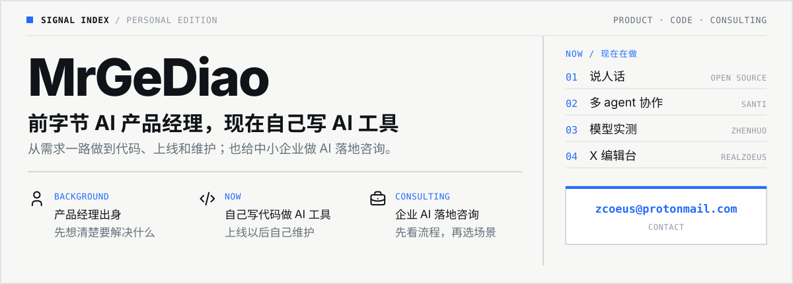
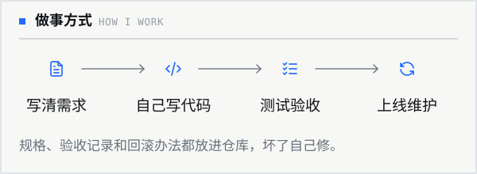
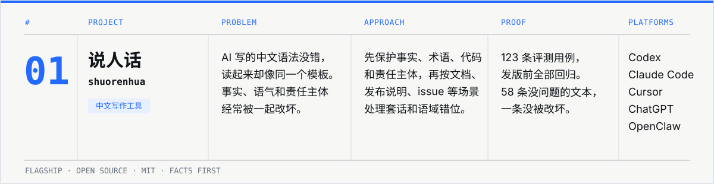
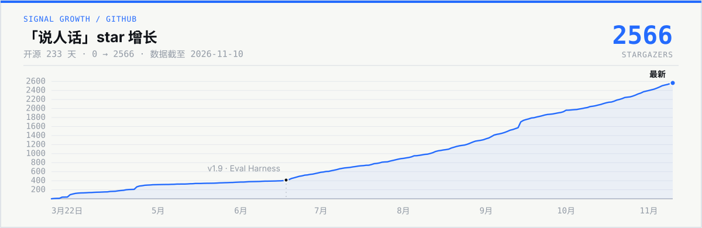
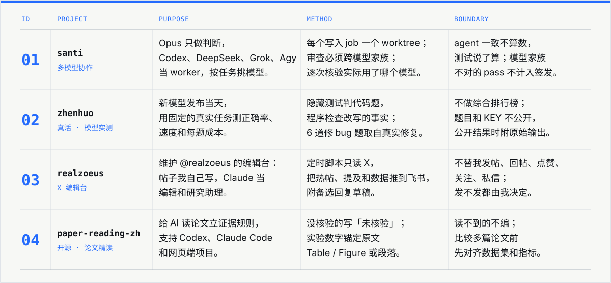
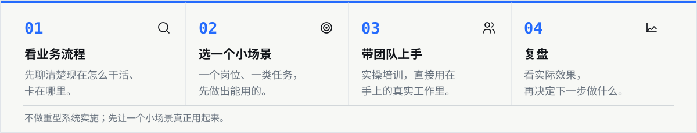

Ex-ByteDance AI product manager, now building and maintaining my own AI tools. I also help small businesses put AI to work.

## 关于我 ABOUT

以前在字节跳动做 AI 产品经理。现在碰到值得做的问题，我会自己从需求一路做到代码、上线和维护，平时主要用 Claude Code 和 Codex 干活。

我在意模型交出来的东西靠不靠得住：改过的文字有没有丢掉原意，新模型到底值不值得换，几个 agent 一起干活时谁来验收。手上的项目大多围着这几个问题。另外也在给中小企业做 AI 落地的咨询和培训。

<table>
  <tr>
    <td width="50%" valign="top">
      
       
      Claude Code · Codex · DeepSeek Harness · Grok CLI · Antigravity · MCP
    </td>
    <td width="50%" valign="top">
      
    </td>
  </tr>
</table>

## 代表作 FLAGSHIP

&nbsp;

`说人话` 是一个中文优先的去 AI 味改写 skill，起因是我自己受不了 AI 腔。它先保住事实、数字、条件和作者的口气，再删套话和重复铺垫；原文没问题就不改。每次发版前跑 123 条回归：v2.6.0 里，58 条本来没问题的文本一条没被改坏，1 条丢了信息，结果都写在[公开评测](https://github.com/MrGeDiao/shuorenhua/blob/main/evals/results-v2.6.0.md)里。

## 现在还在做 ACTIVE WORK

前三个仓库暂时没有公开。[`paper-reading-zh`](https://github.com/MrGeDiao/paper-reading-zh) 已经开源，支持 Codex、Claude Code、Claude Project 和 ChatGPT Project。

展开看私有项目细节

### `santi` / 三体

Opus 能力强，额度也贵，`santi` 让它只做判断：拆任务、写任务卡、读报告、做取舍。读代码和写代码交给 Codex、DeepSeek、Grok、Agy 这些 worker，任务并行跑，写入只发生在各自的 git worktree 里。审查方和实现方必须来自不同模型家族，每个 pass 都核对实际是哪个模型答的，最后放行靠可复现的验证，agent 之间意见一致不算数。

### `zhenhuo` / 真活

我不做综合排行榜，只想知道这活交给新模型行不行、多快、多少钱。`真活` 在新模型发布当天用一套固定的真实任务跑一遍，覆盖代码实现、代码审查、产品评审、中文改写、材料抽取和修 bug。修 bug 的题取自 `santi` 和说人话的真实修复提交，补丁打到修复前的代码上，跑当时补的回归测试。现在是 v0.1，题目和判分 KEY 不公开，避免被训练集吃进去。

### `realzoeus` / X 编辑台

我 X 账号的编辑台。帖子我自己写、自己发，Claude 在这里当编辑和研究助理，逐句核对事实和立场。定时脚本只读 X，把热帖、大号新帖、回复提及和发帖数据推到飞书，需要回复的附备选草稿，我挑一条改改再发。这里的一切都不会替我发帖、回帖、点赞、关注或私信。

## AI 落地咨询 CONSULTING

面向中小企业做 AI 落地的培训和咨询。有合作或交流的想法，欢迎发邮件。

---

